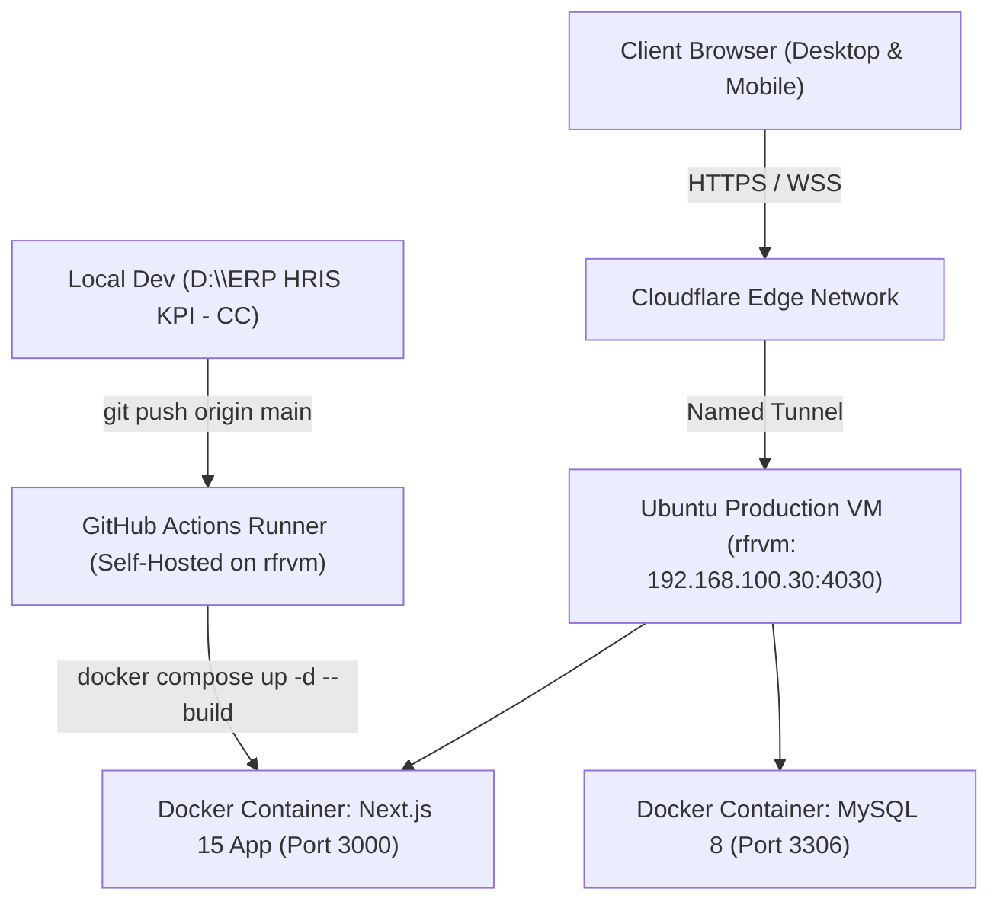
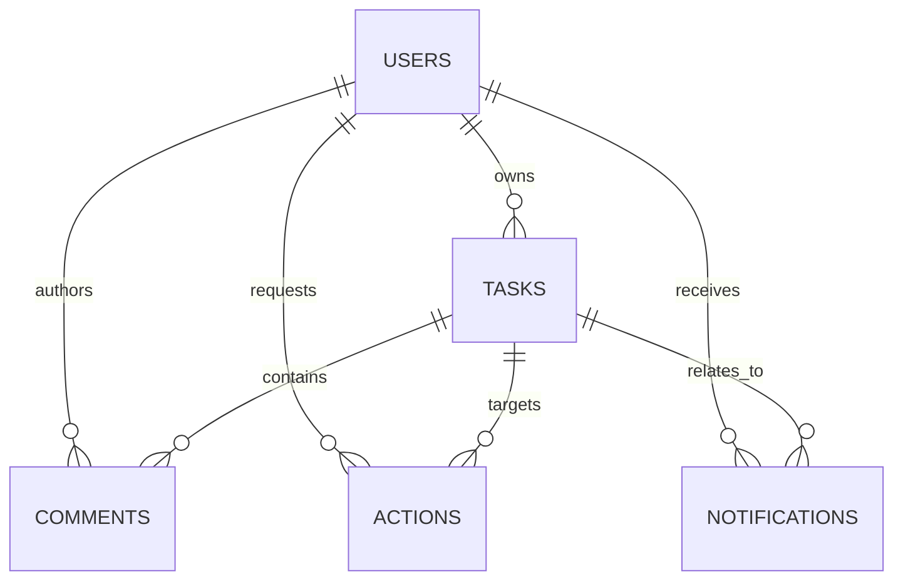
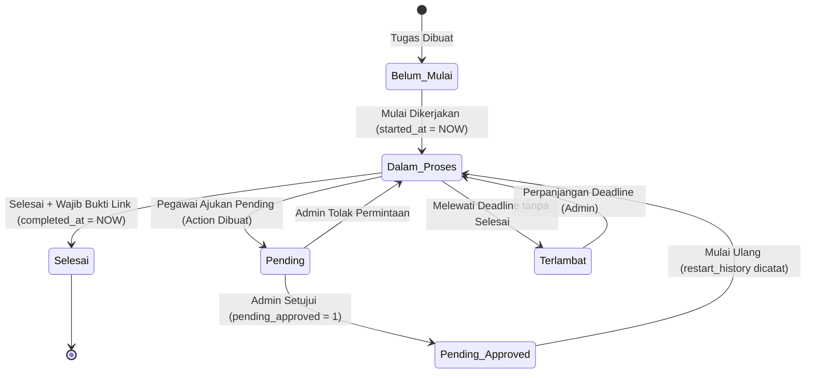

# 📘 System Architecture, SRS Workflows, and Engineering Master Context
**Management Monitor — Enterprise Task Performance & HRIS KPI System**

> [!IMPORTANT]
> **Tujuan Dokumen Ini:**
> Dokumen ini adalah **Master Context & Handover Directive** komprehensif yang dirancang agar AI assistant pada sesi-sesi berikutnya dapat **langsung memahami 100% konteks sistem**, teknologi, alur bisnis (SRS), skema basis data, dan seluruh riwayat perbaikan yang telah dikerjakan tanpa perlu melakukan reverse-engineering ulang.

---

## 1. Identitas Sistem & Gambaran Umum (System Overview)

- **Nama Sistem:** Management Monitor (MM) / Task Performance Monitor System (ERP HRIS KPI).
- **Domain Produksi:** [https://erpkpi.hazra.biz.id](https://erpkpi.hazra.biz.id) (Terkoneksi via Cloudflare Tunnel).
- **Workspace Lokal:** `D:\ERP HRIS KPI - CC`
- **Tujuan Utama:**
  Sistem tata kelola kinerja terpadu (*Enterprise Task & Performance Management*) untuk memantau eksekusi pekerjaan secara *real-time*, mengukur akuntabilitas berbasis data, menghitung skor evaluasi KPI objektif pegawai, mengelola persetujuan penundaan/kendala, serta memberikan wawasan operasional manajerial.

---

## 2. Arsitektur & Tumpukan Teknologi (Technology Stack)



### 2.1 Frontend & User Interface
- **Framework:** Next.js 15.5.4 (App Router, Server & Client Components).
- **Core Library:** React 19.1.0, React DOM 19.1.0.
- **Language:** TypeScript 5.7.2 (`strict: true`, zero `any` on critical boundaries).
- **Styling:** Tailwind CSS v4 (`@tailwindcss/postcss ^4.1.14`, dynamic CSS variables).
- **Design System:** **Mitra UI Enterprise Standards** (Clean semantic palettes, `.panel-card`, `.table-wrap`, tactile button feedback `active:scale-[0.98]`, zero AI-slop, accessible WCAG contrast).
- **Iconography:** Lucide React (`^0.468.0`).

### 2.2 Backend & Data Layer
- **API Runtime:** Next.js Route Handlers (`src/app/api/*`).
- **Database:** MySQL 8.x (Connection Pool via `mysql2/promise` with transactions, `timezone: '+07:00'`).
- **Authentication:** Stateless JWT (`jose ^6.0.11`, HS256, 7-day expiration) disimpan pada **HttpOnly Secure SameSite Lax Cookie** (`mm_token`).
- **Password Security:** Salted hashing menggunakan `bcryptjs ^3.0.2` (10 rounds).
- **Validation:** Zod (`^3.24.1`) & strict TypeScript database contract interfaces (`src/types/database.ts`).

### 2.3 Server & Infrastruktur Produksi
- **Production Server:** Ubuntu VM `rfrvm` (`192.168.100.30`, port SSH `4030`, user `rfrvmuser1`, sudo `D@rat4n$`).
- **CI/CD Pipeline:** Self-hosted GitHub Actions runner terpasang di VM `rfrvm`. Trigger otomatis pada `git push origin main` yang mengeksekusi `docker compose up -d --build --remove-orphans`.
- **Public Gateway:** Cloudflare Named Tunnel (`erpkpi.hazra.biz.id`).

---

## 3. Skema Basis Data & Optimasi Performa (Database Schema & Indexes)



### Tabel-Tabel Utama:
1. **`users`**:
   - Kolom: `id` (PK), `full_name`, `email` (UNIQUE), `password_hash`, `department`, `job_title`, `role` (`admin`|`user`), `status` (`active`|`pending`|`rejected`), `avatar_initials`, `last_activity_at`, `created_at`, `updated_at`.
2. **`tasks`**:
   - Kolom: `id` (PK), `code` (e.g. `MM-0001`), `title`, `description`, `category`, `priority` (`Kritis`|`Tinggi`|`Menengah`|`Rendah`), `status` (`Belum Mulai`|`Dalam Proses`|`Pending`|`Selesai`|`Terlambat`), `owner_id` (FK -> `users.id`), `deadline`, `started_at`, `completed_at`, `evidence_url`, `evidence_photo_name`, `pending_reason`, `pending_requested_at`, `pending_approved`, `restart_history` (JSON), `is_demo_eval` (TINYINT), `created_at`, `updated_at`.
3. **`comments`**:
   - Kolom: `id` (PK), `task_id` (FK), `user_id` (FK), `parent_id` (FK nullable -> `comments.id` untuk komentar berulir), `text`, `created_at`.
4. **`actions`**:
   - Kolom: `id` (PK), `task_id` (FK nullable), `user_id` (FK), `level` (`Kritis`|`Penting`|`Informasi`), `type` (`pending_request`|`registration_approval`), `title`, `body`, `previous_status`, `status` (`pending`|`approved`|`rejected`), `decision_notes`, `created_at`, `resolved_at`.
5. **`notifications`**:
   - Kolom: `id` (PK), `user_id` (FK nullable, NULL = broadcast ke semua admin), `level` (`Kritis`|`Penting`|`Informasi`), `title`, `body`, `task_id` (FK nullable), `is_read` (TINYINT), `created_at`.
6. **`settings`**:
   - Kolom: `key_name` (PK), `key_value`, `description`, `updated_at`.

### Indeks Performa Skala Tinggi (Diterapkan di Seeder):
- `tasks`: `idx_tasks_eval` (`is_demo_eval, deadline, owner_id, status`), `idx_tasks_created` (`created_at`), `idx_tasks_completed` (`completed_at`), `idx_tasks_dashboard` (`is_demo_eval, status, deadline`).
- `comments`: `idx_comments_task_created` (`task_id, created_at`).
- `actions`: `idx_actions_status_created` (`status, created_at`).
- `notifications`: `idx_notif_user_read_created` (`user_id, is_read, created_at`).

---

## 4. Alur Bisnis & Spesifikasi Kebutuhan Sistem (SRS Workflows)

### 4.1 Otentikasi & Otorisasi Berbasis Peran (RBAC)
- **Role `admin` (Super Admin):**
  - Akses tak terbatas ke seluruh modul: Dashboard, Pekerjaan (CRUD penuh), Kalender, Perlu Tindakan (*Approval Center*), Evaluasi & Ranking, Laporan, Manajemen Pengguna, Pengaturan & Seeder.
- **Role `user` (Pegawai):**
  - Akses terbatas: Dashboard personal, Pekerjaan Saya (hanya tugas miliknya), Kalender, Status Permohonan (memantau status pengajuan pending), Evaluasi & Ranking tim, dan Ganti Password mandiri.

### 4.2 Siklus Hidup Pekerjaan (Task Lifecycle)


1. **Pembuatan Tugas (*Task Creation*):**
   - Kode penomoran otomatis berurutan: `MM-XXXX`.
   - **Super Admin** dapat memilih pegawai penanggung jawab (`owner_id`) dari dropdown daftar pegawai aktif.
   - Jika ditugaskan ke pegawai lain, sistem otomatis membuat notifikasi level `Penting` ke pegawai yang bersangkutan.
   - Jika status awal dipilih `Selesai`, kolom `completed_at` langsung diisi waktu saat ini (`NOW()`).
2. **Penyelesaian Tugas (*Task Completion*):**
   - Membutuhkan validasi bukti berupa tautan (`evidence_url`).
   - Mengisi otomatis `completed_at = NOW()`.
3. **Pengajuan Pending:**
   - Pegawai wajib menyertakan alasan penundaan/kendala teknis (`pending_reason`).
   - Sistem membekukan status dan membuat record di tabel `actions` untuk diputuskan oleh Admin.
4. **Edit & Hapus Tugas (*CRUD Management*):**
   - Modal Edit memungkinkan pembaruan judul, deskripsi, tenggat waktu, kategori, prioritas, serta penugasan ulang pegawai oleh Admin.
   - Hapus tugas (*hard delete*) dilindungi konfirmasi pengguna dan otorisasi pemilik/admin.

### 4.3 Alur Persetujuan & Pusat Tindakan (Action Center)
- **Pengajuan Permintaan:** Ketika pegawai mengajukan status *Pending*, entri baru masuk ke `actions` dengan status `pending`.
- **Keputusan Super Admin:**
  - **Setujui (*Approve*):** Status tugas menjadi `Pending`, flag `pending_approved = 1`. Tugas ini dikecualikan dari penalti *late* saat evaluasi.
  - **Tolak (*Reject*):** Status tugas dikembalikan ke status sebelumnya (misal `Dalam Proses`), flag `pending_approved = 0`.
- **Transparansi Pegawai:** Pegawai dapat membuka menu **Status Permohonan** (`/actions`) untuk membaca catatan evaluasi dari admin (`decision_notes`).

### 4.4 Formula Evaluasi Kinerja HRIS KPI (`api/evaluation`)
Skor kinerja dihitung secara matematis berdasarkan pekerjaan yang jatuh tempo dalam periode:
1. **Pekerjaan Jatuh Tempo (*Due Tasks*):** Pekerjaan dengan tenggat waktu dalam periode penilaian yang bukan berstatus `Belum Mulai`.
2. **Tingkat Penyelesaian (*Completion Rate*):**
   $$\text{Completion Rate} = \frac{\text{Tugas Selesai}}{\text{Tugas Jatuh Tempo}} \times 100\%$$
3. **Tingkat Ketepatan Waktu (*Timely Rate*):**
   Hanya menghitung tugas selesai yang bukan hasil penundaan (*eligible completed*):
   $$\text{Timely Rate} = \frac{\text{Tugas Selesai Tepat Waktu}}{\text{Total Tugas Selesai Eligible}} \times 100\%$$
4. **Skor Evaluasi Akhir (*Composite Score*):**
   $$\text{Skor} = (\text{Completion Rate} \times 0.5) + (\text{Timely Rate} \times 0.5)$$
5. **Kategori Capaian:**
   - Skor $\ge 90$: **Sangat baik**
   - Skor $\ge 80$: **Baik**
   - Skor $\ge 70$: **Perlu peningkatan**
   - Skor $< 70$: **Perlu perhatian**
6. **Visual Badges Peringkat:**
   - **Juara #1:** Badge Emas dengan ikon `Award` (`bg-amber-50 text-amber-700 border-amber-200`).
   - **Juara #2:** Badge Perak dengan ikon `Award` (`bg-slate-100 text-slate-700 border-slate-300`).
   - **Juara #3:** Badge Perunggu dengan ikon `Award` (`bg-amber-100/60 text-amber-800 border-amber-300/80`).
   - **Peringkat #4+:** Nomor monospasi standar (`#4`, `#5`, dst.).

---

## 5. Akun Pengguna Bawaan (Seed Users Reference)

| ID | Nama Pengguna | Email | Password | Role | Status | Departemen & Jabatan |
|:--:|---|---|---|:--:|:--:|---|
| **1** | **Super Admin** | `admin@demo.com` | `Admin123` | `admin` | `active` | Administrasi · Administrator sistem |
| **2** | **Aditya Pratama** | `user@demo.com` | `User123` | `user` | `active` | Operasional · Koordinator |
| **3** | **Nadia Putri** | `nadia@example.com` | `User123` | `user` | `active` | Administrasi · Spesialis Administrasi |
| **4** | **Rizky Saputra** | `rizky@example.com` | `User123` | `user` | `active` | Proyek · Staf Proyek |
| **5** | **Sarah Amelia** | `sarah@example.com` | `User123` | `user` | `active` | Operasional · Spesialis Operasional |
| **6** | **Budi Santoso** | `budi@example.com` | `User123` | `user` | `active` | TI · Lead Developer |
| **7** | **Dewi Lestari** | `dewi@example.com` | `User123` | `user` | `active` | Keuangan · Staf Keuangan |
| **8** | **Hendra Wijaya** | `hendra@example.com` | `User123` | `user` | `pending` | Proyek · Manajer Proyek (Uji Approval) |

---

## 6. Riwayat Pekerjaan & Penyelesaian Masalah (Engineering Changelog)

Seluruh riwayat permintaan pengguna dan perbaikan teknis yang telah diimplementasikan:

1. **Pembersihan Statis & Seeder Dinamis (`src/lib/seeder.ts`):**
   - Menghapus keterikatan pada *mock data* statis yang lambat.
   - Membangun *dynamic database seeder* yang menghasilkan data relasional realistis untuk seluruh bulan berjalan, dilengkapi pembuatan indeks performa otomatis.
2. **Penyederhanaan Halaman Login:**
   - Menghilangkan *Choose Account dropdown*, pemilih tema di login, serta mematikan registrasi publik mandiri (pendaftaran dipusatkan via Admin).
3. **Optimasi Performa & Loading State:**
   - Menghapus jeda *artificial loading state* yang berlebihan pada saat *refresh*, sehingga navigasi dan SSR terasa instan.
4. **Pembersihan "AI Slop" pada Seluruh Komponen:**
   - Mengganti lencana gradien yang terlalu generik/slop dengan standar desain **Mitra UI** berbasis token semantik yang bersih.
5. **Penerapan Pagination Universal (`Pagination.tsx`):**
   - Mengimplementasikan komponen pagination modular dengan ringkasan data (*"Menampilkan X–Y dari Z data"*), selektor ukuran per halaman (`10, 20, 50`), tombol taktil `active:scale-[0.98]`, dan elipsis cerdas pada:
     - `TasksView` (tampilan Tabel & Kartu)
     - `UsersView`
     - `ReportsView`
     - `ActionsView`
     - `NotificationsView`
     - `EvaluationView` (Leaderboard & Breakdown tabel)
6. **Peningkatan Modul Evaluasi & Ranking:**
   - Menerapkan badge juara #1 Emas, #2 Perak, #3 Perunggu, perhitungan *global rank* multi-halaman, serta penambahan *Micro Tag* kode tugas.
7. **Resolusi Celah Alur Kritis (*Miss Flows Fixed*):**
   - **Task Assignment:** Menambahkan pemilih pegawai penanggung jawab (`owner_id`) di modal pembuatan tugas oleh Super Admin, disertai notifikasi otomatis kepada pegawai yang ditugaskan.
   - **Task CRUD:** Menambahkan modal Edit rincian pekerjaan serta aksi Hapus Tugas (*Delete*) dengan dialog konfirmasi aman.
   - **Leaderboard Transparan:** Membuka akses evaluasi tim penuh bagi pegawai agar urutan peringkat #1, #2, #3 bermakna dan membenahi narasi kontradiktif pada AI Review.
   - **Pelacakan Permohonan:** Pegawai kini dapat mengakses menu *Status Permohonan* (`/actions`) untuk memantau status persetujuan pending dari Super Admin.
   - **Integritas Selesai:** Mengisi `completed_at = NOW()` pada tugas baru yang dibuat berstatus *Selesai*.
   - **Kalender Lintas Bulan:** Mendukung rentang tanggal 42 sel kalender (`start_date` & `end_date`) sehingga hari transisi awal/akhir bulan tampil akurat.
   - **Sanitasi String Tanggal:** Mencegah eror `Invalid Date` pada Safari/WebKit dengan memastikan `.replace(" ", "T")` pada string tanggal MySQL.
   - **Sinkronisasi History URL:** Menambahkan `window.history.pushState` saat membuka tugas dari notifikasi/tindakan agar tombol *Back* peramban sinkron.
   - **Pembersihan Sidebar:** Menghapus menu *Pendaftaran* dari bilah navigasi pengguna yang sudah login.
8. **Dokumentasi Kredensial Pengguna:**
   - Membuat [`SEED_USERS.md`](file:///D:/ERP%20HRIS%20KPI%20-%20CC/SEED_USERS.md) yang mencatat kredensial login, peran, dan panduan *re-seed*.

---

## 7. Pedoman Wajib untuk AI Sesi Berikutnya (Directives for Future AI)

Saat bekerja di codebase ini pada sesi mendatang, **patuhi aturan ketat berikut**:

1. **Header Kepatuhan Desain:** Selalu sertakan tag komentar `<!-- MITRA-UI-STANDARD-COMPLIANT -->` di awal setiap respons yang memodifikasi atau membahas tampilan antarmuka (UI).
2. **Sintaks Shell Windows:** Terminal berjalan di PowerShell Windows. **JANGAN gunakan operator `&&`**. Selalu gunakan titik koma `;` untuk memisahkan perintah (misal: `Set-Location -Path "..."; npm run typecheck`).
3. **Verifikasi Sebelum Deploy:** Sebelum melakukan commit, selalu jalankan:
   ```powershell
   Set-Location -Path "D:\ERP HRIS KPI - CC"; npm run typecheck
   Set-Location -Path "D:\ERP HRIS KPI - CC"; npm run build
   ```
4. **Alur Deployment Otomatis:** Melakukan `git push origin main` secara otomatis memicu runner CI/CD di VM `rfrvm` (`docker compose up -d --build`). Setelah push, lakukan verifikasi via SSH/plink ke runner log dan curl ke `https://erpkpi.hazra.biz.id`.
5. **Integritas Link & Markdown:** Buat tautan klik langsung menggunakan format GitHub markdown dengan skema `file://` dan garis miring (`/`) untuk semua file kode yang direferensikan.
